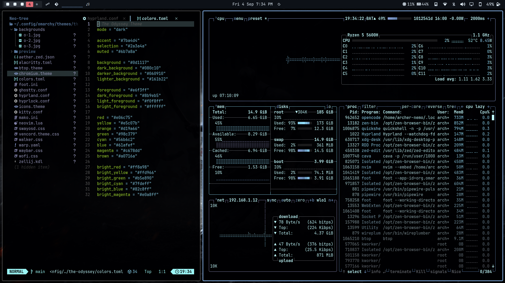
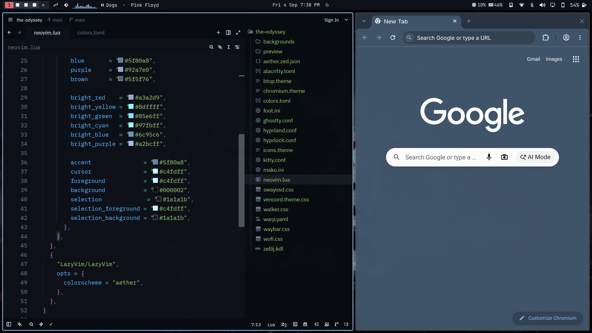
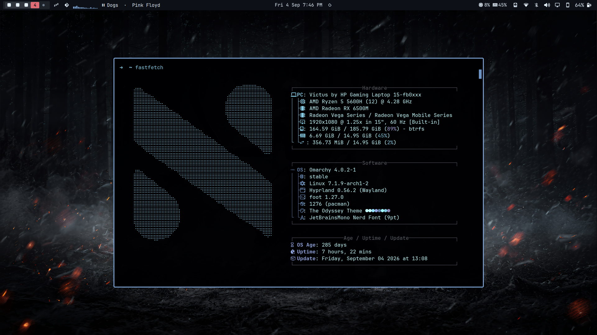
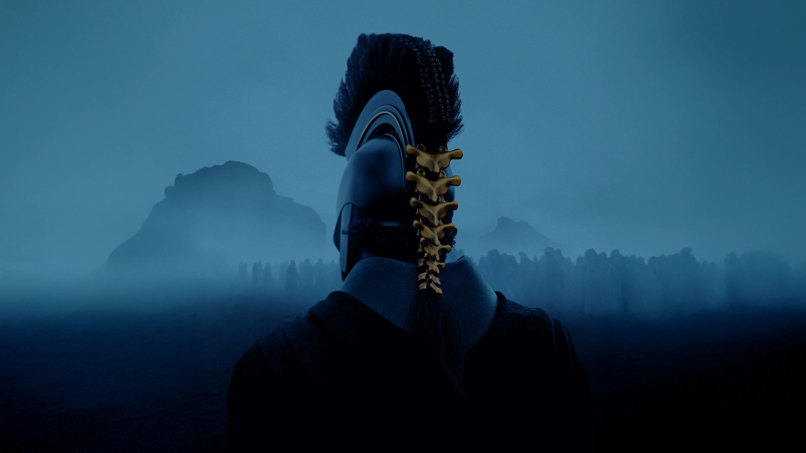
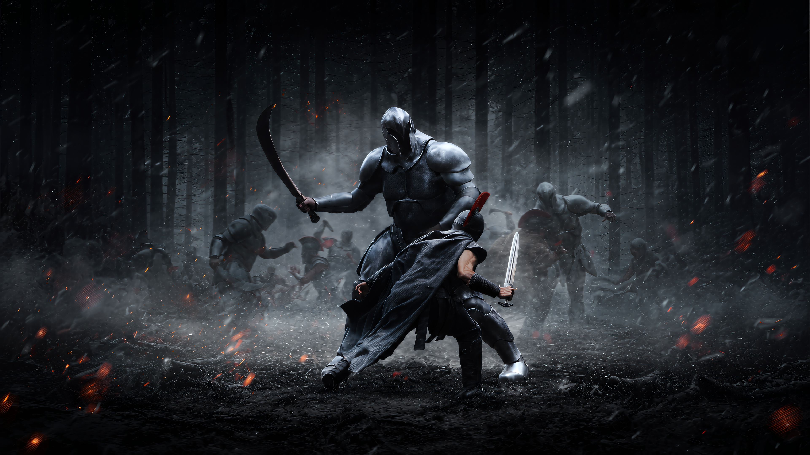
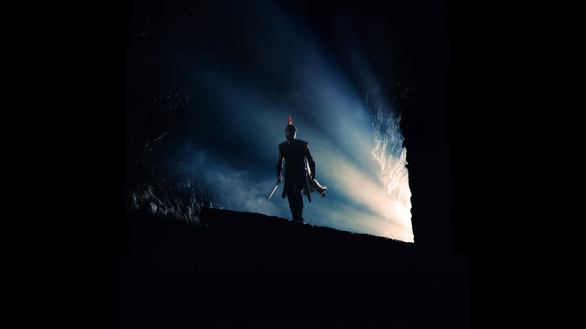

A dark theme for [Omarchy](https://omarchy.org), drawn from Homer's epic *The Odyssey* and its [film adaptation](https://www.imdb.com/title/tt33764258).

## Preview

<p align="center">
  
</p>
<p align="center">
  
  
  
</p>

## Wallpapers

<p align="center">
  
  
  
</p>

## Installation

To install this theme:

```bash
omarchy theme install https://github.com/Nirmal314/omarchy-the-odyssey-theme
```

## Color Palette

<table>
  <tr>
    <td align="center"><br><sub>Background</sub><br><code>#0d1117</code></td>
    <td align="center"><br><sub>Lighter BG</sub><br><code>#161b22</code></td>
    <td align="center"><br><sub>Selection</sub><br><code>#2a3a4a</code></td>
    <td align="center"><br><sub>Muted</sub><br><code>#6b7a8a</code></td>
    <td align="center"><br><sub>Foreground</sub><br><code>#e6f3ff</code></td>
    <td align="center"><br><sub>Accent</sub><br><code>#7ba4d4</code></td>
  </tr>
  <tr>
    <td align="center"><br><sub>Dark FG</sub><br><code>#8b9eb5</code></td>
    <td align="center"><br><sub>Light FG</sub><br><code>#f0f8ff</code></td>
    <td align="center"><br><sub>Bright FG</sub><br><code>#ffffff</code></td>
    <td align="center"><br><sub>Red</sub><br><code>#e06c75</code></td>
    <td align="center"><br><sub>Green</sub><br><code>#98c379</code></td>
    <td align="center"><br><sub>Yellow</sub><br><code>#e5c07b</code></td>
  </tr>
  <tr>
    <td align="center"><br><sub>Magenta</sub><br><code>#c678dd</code></td>
    <td align="center"><br><sub>Cyan</sub><br><code>#56b6c2</code></td>
    <td align="center"><br><sub>Bright Red</sub><br><code>#ff8a98</code></td>
    <td align="center"><br><sub>Bright Green</sub><br><code>#b5e890</code></td>
    <td align="center"><br><sub>Bright Yellow</sub><br><code>#ffd966</code></td>
    <td align="center"><br><sub>Orange</sub><br><code>#d19a66</code></td>
  </tr>
</table>
