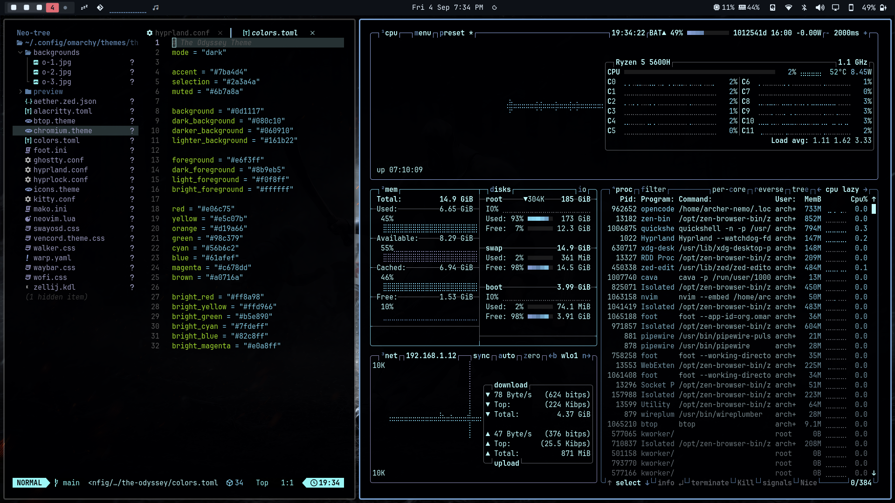
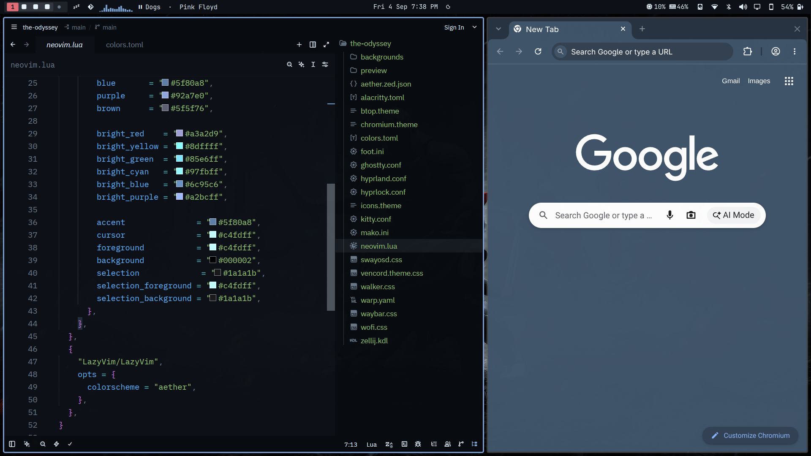
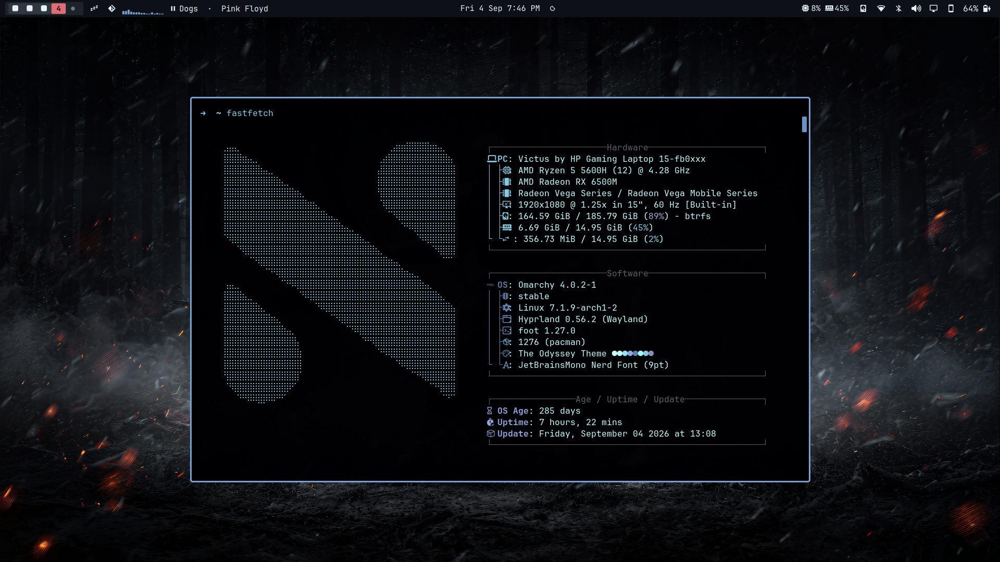
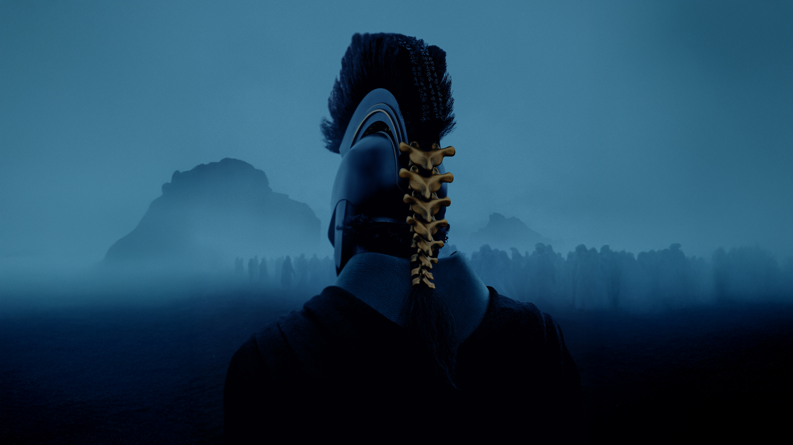
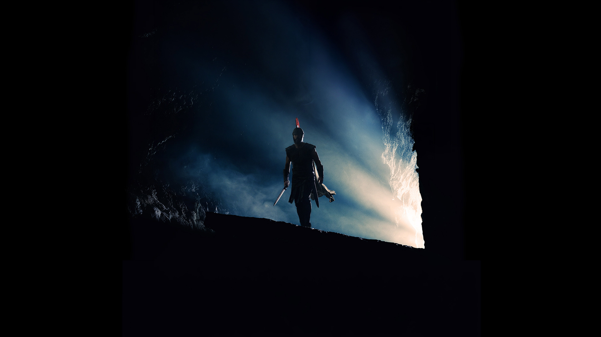

A theme drawn from Homer's epic *The Odyssey* and its [film adaptation](https://www.imdb.com/title/tt33764258) for [Omarchy.org](https://omarchy.org).

## Preview

<p align="center">
  
</p>
<p align="center">
  
</p>
<p align="center">
  
</p>

## Wallpapers

<p align="center">
  
</p>
<p align="center">
  
</p>
<p align="center">
  
</p>

## Installation

To install this theme:

```bash
omarchy-theme-install https://github.com/Nirmal314/omarchy-the-odyssey-theme
```

## Compatibility

This theme includes configurations for:

- **Terminal Emulators**: Alacritty, Foot, Ghostty, Kitty
- **Window Manager**: Hyprland, Hyprlock
- **Bar**: Waybar
- **Application Launcher**: Wofi, Walker
- **Notification Daemon**: Mako
- **Editor**: Neovim, Zed
- **System Monitor**: btop
- **Browser**: Chromium
- **Other**: Zellij, Vencord, SwayOSD, Warp
